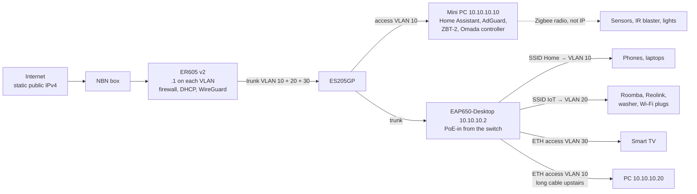
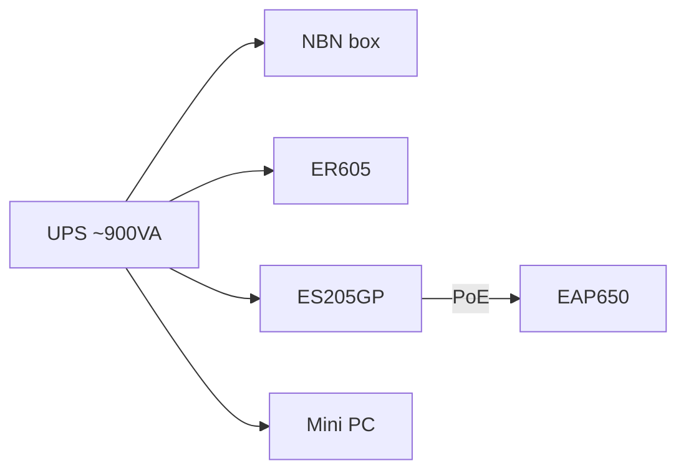

# Home network

Locked design. Three VLANs, PC cabled from the EAP650, Roomba cloud schedule, camera alerts through Home Assistant, DNS fallback, one UPS.

The Archer AXE5400 is replaced by an Omada ER605 v2 and removed from the path. Leaving it in front creates a second NAT and wastes the static public IPv4.

## Diagram

Physical power, not a VLAN:

The TV, heat pump, and washer stay off the UPS.

## Subnets

| VLAN | Name | Subnet | Gateway | Members |
|---|---|---|---|---|
| 10 | Trusted | 10.10.10.0/24 | 10.10.10.1 | Mini PC .10, PC .20, EAP650 .2, switch .3, phones |
| 20 | IoT | 10.10.20.0/24 | 10.10.20.1 | Roomba, Reolink, washer, Wi-Fi plugs |
| 30 | Media | 10.10.30.0/24 | 10.10.30.1 | Smart TV and anything cast to |
| — | WireGuard | 10.10.40.0/24 | — | Phone and laptop when away. Never on the switch. |

/24 each. Do not use 192.168.0.0/24 or 192.168.1.0/24. Those collide with café Wi-Fi when the tunnel is up.

Reservations are by MAC on VLAN 10. IoT and Media stay dynamic unless a rule needs a fixed address.

IPv6 is off on the gateway until the same three zones exist in v6. A v4-only ruleset is a bypass.

## Switch and AP ports

The ES205GP only carries tags. It does not route.

| Device | Port | Mode | Connected to |
|---|---|---|---|
| ER605 | LAN | Trunk 10, 20, 30 | ES205GP |
| ES205GP | toward gateway | Trunk 10, 20, 30 | ER605 |
| ES205GP | toward Mini PC | Access 10 | Mini PC |
| ES205GP | toward AP | Trunk 10, 20, 30. PoE on. | EAP650 uplink |
| EAP650 | uplink | Trunk. PoE-in. | ES205GP |
| EAP650 | ETH | Access 30, untagged | Smart TV |
| EAP650 | ETH | Access 10, untagged | Long cable to the upstairs PC |
| EAP650 | last ETH | Unused | Nothing |

PoE-out on the EAP650 stays off. One of its Ethernet ports can feed power downstream, and the PC port is not a powered device.

The upstairs cable is a single untagged VLAN 10. An unmanaged switch or the Wavlink hung on that same cable is also VLAN 10. That is correct for the PC. It cannot carry the IoT SSID or the Media VLAN. Those stay on the EAP650.

Loop prevention on the ES205GP stays on.

## SSIDs

| SSID | VLAN | Isolation | Use |
|---|---|---|---|
| Home | 10 | Off | Phones and laptops |
| IoT | 20 | On | Roomba, Reolink, washer, plugs |
| Media, only if a streamer is wireless | 30 | Off | A device that must see the TV |

Three different passphrases: router admin, Home SSID, IoT SSID. The Media SSID gets its own if it exists. WPS off. UPnP off. WAN admin off. Admin password is not the Wi-Fi password.

## DNS

AdGuard Home on the Mini PC at 10.10.10.10, as a Home Assistant add-on. Upstream is DNS-over-HTTPS to Quad9 or Cloudflare.

DHCP on every VLAN:

| Order | Resolver | When it is used |
|---|---|---|
| Primary | 10.10.10.10 | Mini PC is up. Filtering works. |
| Secondary | 9.9.9.9 Quad9 | Mini PC is down or not answering. House still resolves. Filtering is off. |

Do not use the ISP resolver as the secondary.

| VLAN | AdGuard policy |
|---|---|
| 10 Trusted | Privacy lists. This is the blocker doing its job, for the PC and phones. |
| 30 Media | Malware only. Do not block Netflix, YouTube, Stan, Binge, Disney+, iview, Kayo, or 9Now. |
| 20 IoT | Malware only. iRobot stays allowed, or the cloud schedule never runs. |

VLAN 20 and VLAN 30 may reach 10.10.10.10 on UDP/TCP 53 and no other address on VLAN 10.

Drop outbound 53 and 853 from all three VLANs except to 10.10.10.10. That does not stop DNS-over-HTTPS inside 443. Do not intercept TLS.

On phones, turn off iCloud Private Relay and Android Private DNS for this Wi-Fi, or the privacy lists never see them.

Some clients try the secondary resolver even when AdGuard is only slow. A few queries leak. That is the cost of the fallback.

## Firewall

Stateful, first match. Omada ACLs are direction-specific: a rule one way does not imply the reply. When something half-works, the missing rule is the return.

1. Allow established and related, every interface.
2. Allow VLAN 10 to VLAN 20, and VLAN 10 to VLAN 30.
3. Allow VLAN 20 and VLAN 30 to 10.10.10.10 on port 53 only.
4. Allow VLAN 20 to the internet on UDP 123 and TCP 443. The Roomba schedule is this rule.
5. Allow VLAN 30 to the internet on UDP 123, TCP 80, and TCP 443.
6. mDNS, UDP 5353, both directions, between VLAN 10 and VLAN 30 only. Never toward VLAN 20.
7. Deny VLAN 20 to 10.10.10.0/24 and to 10.10.30.0/24.
8. Deny VLAN 30 to 10.10.10.0/24 and to 10.10.20.0/24. Rule 6 is the only exception.
9. Deny VLAN 20 to itself at Layer 3, and keep client isolation on the IoT SSID.
10. From the internet, allow only the WireGuard UDP port. Not 8123, not RTSP, not the TV, not the switch.

Switch and AP management addresses stay on VLAN 10. VLAN 20 and VLAN 30 have no route to them.

### Casting

The phone is on VLAN 10. The TV is on VLAN 30. Discovery crosses only via the mDNS rule. The session itself rides the allow from VLAN 10 to VLAN 30.

If the TV appears and the cast dies on tap, the TV is opening a session back toward the phone. Add a return allow from VLAN 30 to VLAN 10 for the cast ports only, after that failure is seen. Do not open VLAN 30 to VLAN 10 in general.

mDNS is repeated by the Omada controller on the Mini PC. Casting discovery stops while that box is off. An app already open on the TV does not need it.

## VPN

WireGuard terminates on the ER605. One UDP port forward. Firmware 2.3.2 or later.

| Setting | Value |
|---|---|
| Tunnel | 10.10.40.0/24 |
| Phone AllowedIPs | 10.10.10.0/24, 10.10.20.0/24, 10.10.30.0/24, 10.10.40.0/24 |
| VLAN 20 and 30 default route | Straight out the NBN. Never into the tunnel. |
| Commercial VPN client on the gateway | Off |

No other port is published. The static address makes the tunnel reliable. It is not a reason to expose Home Assistant or the camera.

## Away from home

| Want | Path | VPN |
|---|---|---|
| Zigbee sensor state, camera alert | Mini PC pushes out to Apple or Google. The phone is on mobile data. | No |
| Open Home Assistant, view the camera, start the Roomba from Home Assistant | Phone joins WireGuard, then uses 10.10.10.10 | Yes |
| Roomba cloud schedule | Roomba on VLAN 20 calls iRobot on TCP 443. The phone is not involved. | No |

The Reolink is viewed through Home Assistant, which pulls it from VLAN 20. It is not joined to the Reolink cloud for remote viewing. If the camera will not stay online without that cloud, allow its outbound 443 and still do not forward a port to it.

Zigbee never hits the firewall. Sensors and the IR blaster talk radio to the ZBT-2, then USB to the Mini PC. Place the coordinator for coverage. Away-from-home access to those sensors is Home Assistant over the tunnel, plus the outbound push for alerts.

## Power

One line-interactive UPS, about 900VA. A rental has one circuit. A second UPS is a spare, not a second feed.

On the UPS: NBN box, ER605, ES205GP, Mini PC. The EAP650 draws about 17 W with PoE-out off and is powered by the switch, so it stays up with the switch.

Load is roughly 70 to 80 W. On a 900VA unit that is on the order of half an hour to an hour.

Home Assistant NUT shuts the Mini PC down with a few minutes of battery left. The gateway may run until the battery is empty. A hard cut is what corrupts Home Assistant.

The Roomba, the Zigbee sensors, and the solar Reolink ride through on their own batteries. The UPS protects the path they report through.

## Management

- Omada software controller on the Mini PC. No OC200.
- One NTP source for the gateway, the Mini PC, and the time option in DHCP.
- Home Assistant snapshots to a USB disk on the Mini PC.
- Export the ER605 and ES205GP config after every rule change.
- Write AdGuard allows from a week of query logs, per client, not from a guessed vendor list.
- Do not add 802.1X, MAC allow-lists, or a second NAT router.
