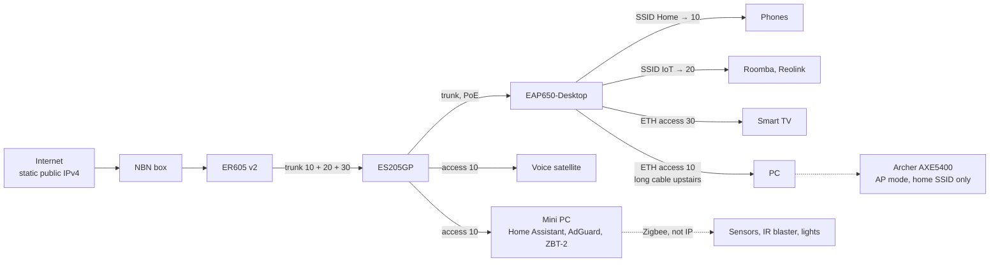

# Architecture

A rental home in Melbourne, one NBN service (500 Mbps), no wall or ceiling drilling. The design splits the house into three networks and puts the firewall on a gateway that can actually enforce it.



## Traffic path

```text
NBN (static public IP, CGNAT opted out)
        │
        ▼
     NBN NTD
        │
        ▼
 Omada ER605          ← only device that routes and firewalls
        │ trunk VLAN 10 + 20 + 30
        ▼
 Omada ES205GP        ← VLAN tags + PoE, no security policy
        │
        ├── Mini PC (Home Assistant, AdGuard, ZBT-2)   VLAN 10
        ├── voice satellite                             VLAN 10
        └── EAP650-Desktop (hallway, PoE)               trunk
                ├── ETH → upstairs PC                   VLAN 10 access
                │         └── Archer AXE5400, AP mode   same cable, VLAN 10 only
                └── ETH → Smart TV                      VLAN 30 access
```

The long cable starts at the EAP650, not at the switch. That was the point of the desktop AP: one trunk from the cabinet, then short or single runs from the hallway.

IoT devices do not plug into the switch. They join an SSID that the EAP650 drops onto VLAN 20, or they speak Zigbee to the coordinator on the Mini PC. Zigbee is a radio mesh. It is not Wi-Fi and it is not a VLAN.

The upstairs cable is untagged VLAN 10. An unmanaged switch at that end can feed the PC and the Archer. Both are VLAN 10. The Archer cannot advertise the IoT or Media SSID on the right VLAN from that cable. Those SSIDs stay on the EAP650.

## Why each hop exists

| Hop | Decision |
|-----|----------|
| ER605 in front of everything | The Archer AXE5400 cannot do real inter-VLAN firewall rules. The gateway is the policy point. |
| ES205GP under the gateway | Tags VLANs and powers the hallway AP. A switch does not replace a router. |
| EAP650 in the hallway | One cable from the switch. Its extra ports feed the upstairs PC and the TV. |
| PC on EAP650, not on the ES205GP | Avoids a second long cable from the cabinet all the way upstairs. |
| Archer at the upstairs end of that cable | Reuses the radio already bought. Access-point mode, home SSID only. It is not the gateway. |
| Mini PC on VLAN 10, wired to the switch | The automation host must be allowed *into* IoT and media. It must not sit *on* those VLANs. |
| No second router | A second NAT router would hide devices, break Home Assistant discovery, and add nothing the ER605 does not already do. |

## VLANs

| ID | Name | Subnet | What lives here | Default policy |
|----|------|--------|-----------------|----------------|
| 10 | Trusted | 10.10.10.0/24 | Mini PC, voice satellite, PC, phones, Archer management | Full LAN |
| 20 | IoT | 10.10.20.0/24 | Cameras, Roomba, lights, sensors, heat-pump IR | Internet only. No path to VLAN 10. |
| 30 | Media | 10.10.30.0/24 | Smart TV, console, projector | Internet only. No path to VLAN 10, except mDNS for casting. |

Addresses, DNS, and the firewall table are in [vlans-and-firewall.md](vlans-and-firewall.md).

The Mini PC is the exception to the deny rules. It may start connections into VLAN 20 and VLAN 30 so Home Assistant can poll and control devices. Those VLANs cannot start connections back, except DNS to the Mini PC on port 53 and mDNS between VLAN 10 and VLAN 30.

## What is local vs cloud

| Stays in the house | Leaves the house |
|--------------------|------------------|
| Zigbee sensors, IR blaster, Home Assistant logic | NBN itself |
| Wake word on the satellite | Claude API (conversation only) |
| Switch, gateway, APs | ElevenLabs TTS |
| Camera viewed through Home Assistant | iRobot cloud, so the Roomba schedule runs while you are away |
| | Push alerts from Home Assistant to the phone |

Voice audio is sent out only after speech-to-text, as text, to the model. Claude is a conversation agent inside an Assist pipeline. It is not given the Home Assistant API and it is not connected over MCP.

## Physical constraints that shaped the drawing

- Rental: no drilling into brick, gyprock, or the sealed glass sliding door.
- Backyard camera is wireless and solar because there is no honest cable path outside.
- The hallway is too narrow for a cabinet, so the EAP650-Desktop sits on a shelf or ledge, not in a box.
- The NBN box, ER605, ES205GP, and Mini PC share one freestanding cabinet in a bedroom. One UPS feeds those four. The EAP650 is powered by the switch.
- The ZBT-2 is USB. It sits next to the Mini PC. A hallway radio position would need the Mini PC, or a short USB extension, in that hallway. A long USB lead is a bad radio and a bad cable.
- PoE-out on the EAP650 stays off. The PC port is not a powered device.

## How to prove the drawing is true

Do this after the VLANs exist, before calling the project finished:

1. From a VLAN 20 client, ping the Mini PC. It must fail.
2. From a VLAN 30 client, open the Home Assistant port. It must fail.
3. From the Mini PC, ping a known IoT address. It must succeed.
4. From each VLAN, load a normal website. It must succeed.
5. Unplug the EAP650 uplink. The upstairs PC, the TV, and hallway Wi-Fi drop. The Mini PC, which is on the switch, stays up.
6. Cast from a phone on VLAN 10 to the TV. Discovery must work. A VLAN 20 client must not see that mDNS.

If step 1 succeeds, the VLANs are only labels. The firewall is not on.
